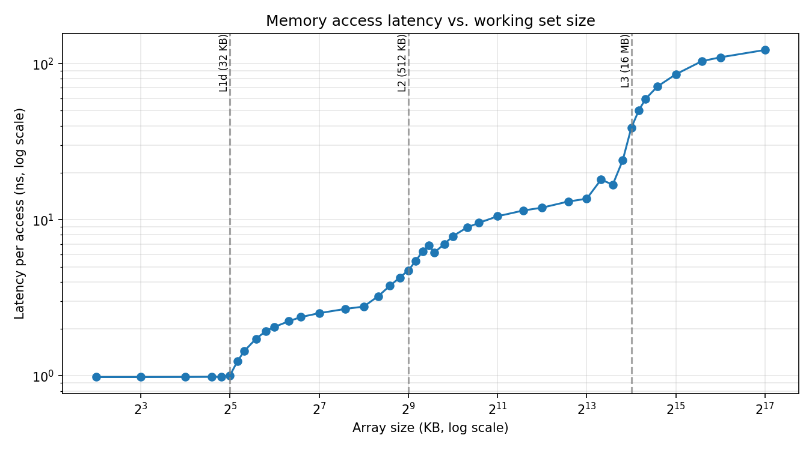

# Cache Latency Microbenchmark

A C microbenchmark that measures memory access latency as a function of working-set size, exposing the L1, L2, L3, and DRAM levels of the memory hierarchy.

**Method:** pointer chasing over a randomly shuffled single cycle (Sattolo shuffle). Every load depends on the previous one, so loads cannot overlap and the prefetcher cannot predict the next address. Each size is measured 5 times (200M dependent loads per run); the median is reported.

## Build and run

```
gcc -O2 sweep.c -o sweep
.\sweep.exe > results.csv     # PowerShell (writes UTF-16, which plot.py expects)
python plot.py                # writes latency_curve.png
```

A full sweep takes 30+ minutes. Run plugged in, on a high-performance power mode, with other apps closed.

## Results



Machine: `[CPU model]`, 6 cores / 12 threads, native Windows, gcc `-O2`.
Clock during runs ~4 GHz (cycle counts below assume this).

| Level | Documented | Measured | Latency |
|---|---|---|---|
| L1d | 32 KB per core | flat through 28 KB, rises from 32-36 KB | ~0.98 ns (~4 cycles) |
| L2 | 512 KB per core | rises from ~320 KB, exits by ~770 KB | ~2.5-2.8 ns (~10-11 cycles) at 128-256 KB |
| L3 | 16 MB shared | rises from ~10 MB, near DRAM by ~25-32 MB | ~8-13 ns (~32-54 cycles) at 1-8 MB |
| DRAM | n/a | 32-128 MB | ~85-122 ns, still rising with size |

Measured L1 and L2 boundaries match the documented sizes. Effective L3 capacity for a random working set was roughly 8-10 MB, below the nominal 16 MB.

## Notes

- Short runs (20M loads) under-read speed because the CPU clock had not ramped up; 200M loads gave stable L1 numbers.
- Pinning the thread to one core made no visible difference.
- Plateaus slope upward rather than staying flat. Likely causes are TLB reach (4 KB pages), cache associativity, and physical page placement. Not isolated experimentally.